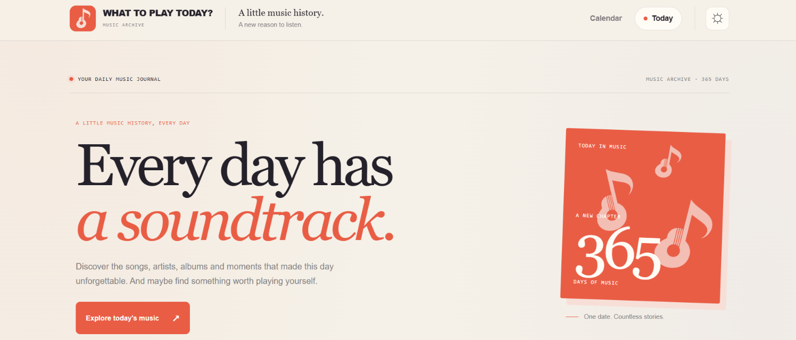
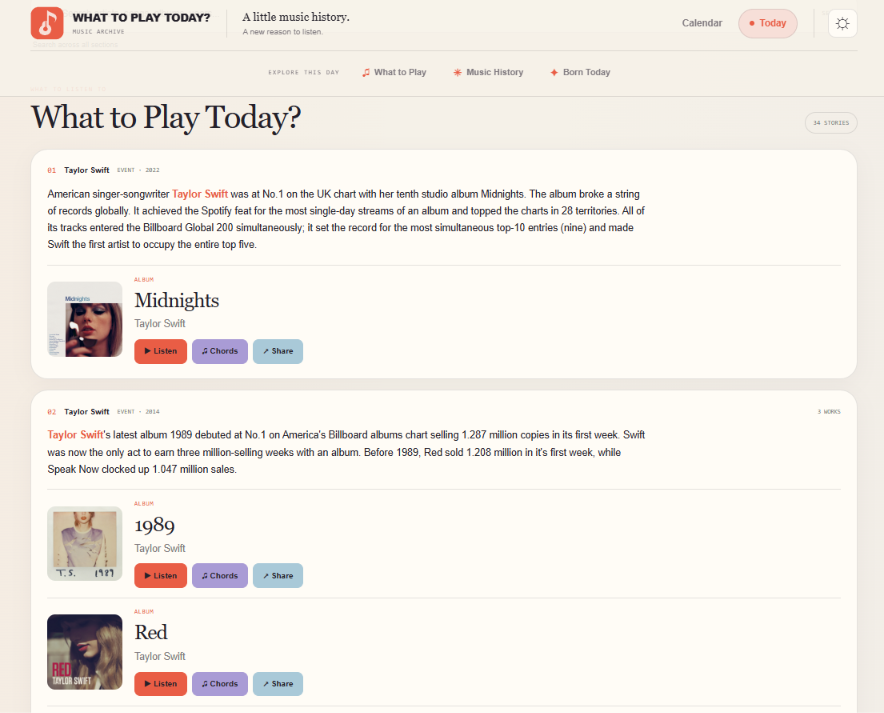

# 🎵 What to Play Today?

**Discover the music history behind every day of the year.**

What to Play Today? is a music discovery website that explores what happened in music history on any given day.

From iconic album releases and legendary performances to artists' birthdays and memorable milestones, discover the stories behind the music — and find something worth listening to today.

🌐 **Website:** [what-to-play-today.pages.dev](https://what-to-play-today.pages.dev/)

## 📸 Screenshots

### Homepage



### Music history by date



## ✨ Features

- **Today in Music History** — discover notable events that happened on this day in music.
- **On This Day** — explore music history by browsing any date of the year.
- **Artist Birthdays** — discover musicians and performers born on each date.
- **Music Releases** — explore albums and songs associated with historical dates.
- **Music Discovery** — find artists, songs, and albums connected to memorable moments in music history.
- **Calendar Navigation** — browse the entire year and jump directly to any date.
- **Search & Filtering** — navigate through historical stories and find artists and events more easily.
- **Light & Dark Themes** — choose the appearance you prefer.

## 🛠️ Tech Stack

- [Astro](https://astro.build/) — static site generation and page architecture.
- JavaScript — data processing and application logic.
- CSS — responsive layouts, visual design, and themes.
- [MusicBrainz](https://musicbrainz.org/) — music metadata validation and enrichment.
- [Wikipedia](https://www.wikipedia.org/) — supplementary artist information and images.
- [Google Gemini](https://ai.google.dev/) — AI-assisted extraction of structured music information from historical event descriptions.
- [Cloudflare Pages](https://pages.cloudflare.com/) — website hosting.
- [GitHub Actions](https://github.com/features/actions) — automated data processing.

## 📂 Project Structure

```text
/
├── public/                 # Static assets
├── src/
│   ├── components/         # Reusable UI components
│   ├── layouts/            # Shared page layouts
│   └── pages/              # Homepage, calendar, and date pages
├── data/
│   ├── prepared/           # Enriched daily music data
│   ├── ai-music/           # AI-extracted music information
│   ├── music-enrichment/   # Music metadata and enrichment cache
│   └── ...                 # Source data and other caches
├── scripts/                # Data processing pipeline
├── screenshots/            # Project screenshots
├── astro.config.mjs
├── package.json
└── README.md
```

## ⚙️ Getting Started

### Requirements

- Node.js 22.23.4 or newer
- npm

### Installation

Clone the repository:

```bash
git clone https://github.com/Anastasiia-A-Petrova/what-to-play-today.git
cd what-to-play-today
```

Install dependencies:

```bash
npm install
```

### Development

Start the local development server:

```bash
npm run dev
```

Astro will make the website available at:

```text
http://localhost:4321
```

### Production Build

Generate the static website:

```bash
npm run build
```

The production-ready files will be generated in the `dist/` directory.

Preview the production build locally:

```bash
npm run preview
```

## 🔄 Data Processing Pipeline

The website uses a separate data preparation pipeline to enrich historical music events with structured music information.

The workflow combines several sources and processing stages:

1. Historical music event descriptions provide the original context.
2. Google Gemini extracts information about artists, songs, and albums.
3. MusicBrainz validates extracted music metadata.
4. Wikipedia provides supplementary artist information and images.
5. Cached results help reduce repeated API requests.

### Configuration

The data extraction pipeline requires a Google Gemini API key.

Create a `.env` file in the project root:

```env
GEMINI_API_KEY=your_gemini_api_key
```

Keep this file private. Do not commit API keys or other secrets to GitHub.

### Running the Pipeline

The main pipeline script is:

```bash
node scripts/run-full-pipeline.cjs
```

To process the next seven days:

```bash
node scripts/run-full-pipeline.cjs --next-days 7
```

The pipeline processes available source data and prepares enriched files for the website.

**Important:** The Astro production build and the data processing pipeline are separate processes. Running `npm run build` uses the prepared data already available in the project; it does not automatically run Gemini extraction or MusicBrainz validation.

## 🚀 Deployment

What to Play Today? is built as a static Astro website and hosted on Cloudflare Pages.

The GitHub repository is used as the source for the project, while GitHub Actions automates periodic music data processing.

🌐 **Live website:** [what-to-play-today.pages.dev](https://what-to-play-today.pages.dev/)

## 💡 Project Goal

Music history is full of fascinating stories, anniversaries, discoveries, and unexpected connections.

**What to Play Today?** brings these stories together in one place, making every day an opportunity to discover something new — or revisit something unforgettable.

---

Made with 🎵 and curiosity.